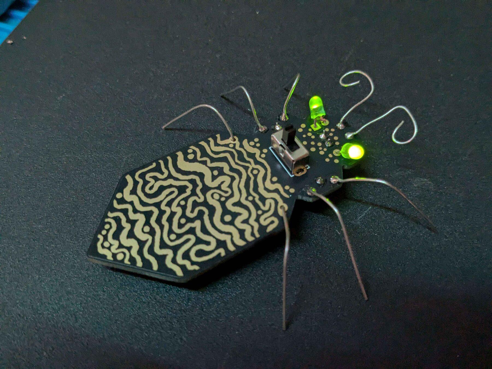

# bugtorial

This badge was made for a workshop. The main topic for the event was "upcycling" - therefore we designed the badge around reusability of old components - the legs and antennas are made from scrap electronic components (we have a lot of these at hackerspace), so are resistors and LEDs too (who uses THT components today anyways).

## License

This repository contains two separately licensed things:

### Hardware — CERN-OHL-P v2

Copyright © 2026 Jakub "critbit" Sadowski.

The electronic design (schematics, PCB layout, routing, and the other design
files in this repository, excluding the artwork described below) is Open
Hardware, licensed under the CERN Open Hardware Licence Version 2 - Permissive.
You may redistribute and modify it under the terms of the
[CERN-OHL-P v2](LICENSES/CERN-OHL-P-2.0.txt) (https://ohwr.org/cern_ohl_p_v2.txt).

It is distributed WITHOUT ANY EXPRESS OR IMPLIED WARRANTY, INCLUDING OF
MERCHANTABILITY, SATISFACTORY QUALITY AND FITNESS FOR A PARTICULAR PURPOSE.
Please see the CERN-OHL-P v2 for applicable conditions.

### Artwork — CC BY-NC-SA 4.0

Copyright © 2026 @weasel.

The artwork is licensed separately from the hardware. The drawings in the
`.svg` files, and the same graphics where they appear in the PCB and
fabrication files (silkscreen, copper, solder mask and board outline, including
Gerbers and other manufacturing outputs), are licensed under
[Creative Commons Attribution-NonCommercial-ShareAlike 4.0 International](LICENSES/CC-BY-NC-SA-4.0.txt)
(https://creativecommons.org/licenses/by-nc-sa/4.0/).

Because the artwork is part of the board layout, a badge manufactured from
these files as-is includes it, so the non-commercial and share-alike conditions
apply to such badges. The CERN-OHL-P terms apply on their own only to the design
with the artwork removed or replaced.

### Other licensing

If the licenses above don't fit what you have in mind, for example running
workshops or events with these badges, or making them in larger batches,
get in touch. We're open to licensing this work on different terms.

Visit [roughrat.com](https://roughrat.com) for contact info.

### How to credit

When you share or build on this project, please credit it like this:

> bugtorial: hardware by Jakub "critbit" Sadowski (CERN-OHL-P v2),
> artwork by @weasel (CC BY-NC-SA 4.0).
